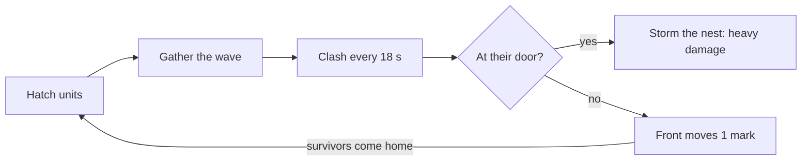

# ANTHOLD Versus developer guide

Last updated 15 November 2026. The editable original is the claude.ai doc "ANTHOLD Versus developer guide" (private to the owner until shared).

## 1. What the game is

ANTHOLD Versus is a 1v1 side-view lane battler. Two colonies of armoured bug knights face each other across one meadow, each guarding a nest. You spend food to hatch units, and your units gather into a wave. Every 18 seconds a clash sends both waves at each other, and the winner pushes the front line one mark toward the enemy nest. A clash won at the enemy's door storms the nest. Break the enemy nest to win the round; a match is best of three.

- **8 classes**, 41 species in total (5 or 6 per class): Ants, Beetles, Butterflies, Flies, Crickets, Scorpions, Bees and Termites. Each class has its own perk, power-ups, deploy rule and nest.
- **Between rounds**, a council screen spends points on power-ups, disasters and one-round tactics.
- **Opponents:** a bot with three difficulties; an online 1v1 mode that works only when the game runs on claude.ai; and an Auto toggle that lets the bot play your side.
- **Platforms:** desktop and phone browsers, in landscape. There is also an installable phone app built from the same file.

**Where it lives**

- The entire game is one file: `versus.html` (about 3,000 lines, about 2.3 MB because all art is embedded as data URIs).
- It is published privately on claude.ai as an artifact; online play uses that page's `room` capability.
- `build-app.py` wraps the same file into an installable phone app in `app/` (a PWA, with online play hidden).
- The art direction is "sentai / Kamen Rider bug knights": humans in armour, never insect bodies. It is documented in the ANTHOLD knight prompts doc and the ANTHOLD species designs doc (section 9).

## 2. Run, test, build and publish

There is no build step for the game itself: open `versus.html` in a browser and it runs. Everything else is a helper around that file.

| Task | How |
| --- | --- |
| Play locally | Open `versus.html` directly, or serve the project folder with any static server. |
| Balance check | `node versus-sim.js 4` plays every class against every other with bots on both sides, N matches per pairing, and prints class win rates and round lengths. It loads the game's script into Node with a stubbed DOM, so it tests logic only. One run with N=1 takes about 2 minutes. |
| Older measurement scripts | `versus-air.js`, `versus-comeback.js`, `versus-matrix.js`, `versus-value.js`, `sim.js` and `drawcheck.js` measured earlier designs. Treat them as stale until checked against the current rules. |
| Phone app | `python build-app.py` writes `app/` (index.html, manifest, service worker, icons). Re-run it after every change; the service worker's cache name changes per build so installed phones update. |
| Publish | The game is published as a private claude.ai artifact. Online play needs that page's `room` capability, so it only works there. |

**Healthy sim numbers today (1 match per pairing):** median round about 188 s, almost no timeouts, every class roughly 35 to 65% (one match per pairing is noisy; use 4 for decisions).

**Gaps a developer should know about**

- **Version control is new.** This repository was created on 15 November 2026; earlier history only exists as a few hand-saved snapshots kept outside the repo.
- **No automated tests.** The sim is the only check. Visual checks so far used a throwaway headless-Chrome script (load the page, run JavaScript, screenshot) that is not in the project. Adding one is the first tooling task.
- **Calling into the game from a test.** Useful globals for scripted checks: `newMatch(cls,diff)`, `startRound()`, `hatch(team,id)`, `setTac(team,k)`, `dossier(cls)`, plus the state objects `M` and `R` (section 3).

## 3. Code map

`versus.html` is CSS, then the HTML for each screen (menu, draft/council, round end, pause, HUD), then one `<script>`. The script is split by banner comments (`// ===... section ...===`); search for the banner text to jump. Line numbers below are approximate and drift with every edit.

| Lines (approx.) | Section | What lives there |
| --- | --- | --- |
| 295-300 | Setup | `$` (getElementById), the canvas, world size `WW=1400, WH=700`, fixed step `DT=1/60` |
| 300-380 | Classes and species | `CLASSES`, `SP` (all species stats), `TRAIT` value weights, `DEPLOY` (per-class hatch rule), `unitValue` |
| 380-455 | Disasters, power-ups, maps, bot levels | `DIS`, `UPS` (six per class), `UP_SCALE`, `MAPS`, `BOT_LEVELS` |
| 456-495 | Match state and terrain | `M`, `R`, `mkPlayer`, `mods` (perks plus power-ups), `newMatch`, `groundY`, `BASE_X`, `startRound` |
| 495-575 | Waves and roles | `WAVE`, `CLASH`, `TACS`, the role triangle (`roleOf`, `BEATS`, `roleMul`), `musterX`, `charge`, `startClash`, `resolveClash`, `forecast`, Auto mode |
| 575-805 | Units | `spawn`, `hatch`, flight (`AIR`, `altOf`, `reachOf`), `hurt`, `hurtBase`, veterans (`VET`, `promote`), `die`, auras, `pickTarget`, `strike`, `land`, `stepUnits`, `stepShots`, `stepBases` |
| 805-890 | Disasters in play, bot, council | `cast`, `stepEffects`, `botThink`, `UP_COST`, `DIS_COST`, `TACTICS`, `councilOffer`, `botDraft` |
| 890-960 | Round loop | `NEST`, sudden death (`OT_AT`, `FINAL_AT`), Last Stand (`STAND`, `callSwarm`), `update()` (one simulation step), `endRound` |
| 960-1530 | Unit art | the old procedural bug models (`SPECIES_MODEL`), then the knight sprites: `KNIGHT_PNG`, `SPECIES_PNG`, `NEST_PNG`, `knightSprite`, `bugSprite` |
| 1525-1905 | Drawing | the baked meadow (`bake`), `drawNest`, `draw()` (per frame: nests, banners, units, shots, effects), disasters on screen |
| 1905-1970 | Tunnel race | the diggers that burrow toward the enemy nest; breaking through starts sudden death |
| 1971-1995 | Class crests | `CREST` images, `sigilSVG`, `sigilImg` |
| 1993-2080 | HUD and screens | `show`, HUD updates, `menu()`, class cards (`CARD_ART`, `CARD_POP`, `knightArt`), `dossier()` |
| 2079-2680 | Menu art | drawn class scenes, pencil studies and class plates. Most of this is from earlier art directions and largely superseded by the knight art. |
| 2681-2705 | Input | keys and pointer |
| 2704-2860 | Online 1v1 | host-authoritative play over the artifact `room` capability |
| 2860-end | Sound | all synthesised with Web Audio; no files |

**State in two objects**

- `M` is the match: players `M.pl[0]` (you) and `M.pl[1]` (the bot or the guest), each with class, food, power-ups (`ups`), disasters (`dis`), tactics and council points; plus round number and score.
- `R` is the round: `units`, `bases` (each nest's hp, max and flash), `shots`, `walls`, `effects`, the front position, each side's tactic, frenzy timers, the clock `R.t` and the countdown.
- `state` says which screen is up. `NET` holds online state (`NET.role` is host or guest).

**Loop.** A `requestAnimationFrame` loop runs `update()` in fixed 1/60 s steps, then `draw()`. The world is 1400 x 700 units, scaled to fit the screen. All rules live in `update()` and the step functions; `draw()` only reads state.

## 4. Game systems

The round is a tug of war on a line of 7 marks (`R.front`, from -3 to 3). Units are bought between clashes, wait at a muster line just behind the front, and fight in timed clashes.

**Economy and hatching**

- Each side starts a round with 40 food and earns about 6 food per second. Bee Foragers add more. The bot's income is scaled by difficulty (`BOT_LEVELS`: 0.8, 1 or 1.2).
- `hatch(team,id)` pays `costOf` (species cost times power-up modifiers), respects the species cooldown (`cd`), and spawns `n` units.
- Each class hatches differently (`DEPLOY`). For example, ants hatch as brood squads, and heavy beetles spend 3.5 s as pupae.

**Waves, clashes and the front** (`CLASH`)

- New units gather at `musterX`, 150 units behind the front and never closer than 150 to their own nest.
- The first clash is at 12 s, then one every 18 s. At the clock, `startClash` charges both waves and reveals tactics.
- `resolveClash` runs 12 s later. The side holding the field moves the front one mark (170 world units).
- A clash won with the front at the enemy door storms the nest (`hurtBase(..., "door")`). Bugs that reach a nest hit it 2.2 times harder (`NEST.hit`).
- Survivors walk home and join the next wave.

**Tactics.** Each side picks one per clash, with keys Z, X and C. Charge beats Flank, Flank beats Hold, Hold beats Charge. The winner of the matchup deals 1.25x damage and the loser 0.85x (`tacMul`). The bot mostly counters what you picked last time (`botTactic`).

**Roles.** Every species is a walker (■), flyer (▲) or ranged (●), shown as a glyph above each unit (`roleOf`). Walkers beat ranged, ranged beat flyers, flyers beat walkers: 1.2x damage on a favourable matchup, 0.85x on a bad one. The HUD forecasts your wave against theirs (`forecast`).

**Flight and reach.** Flyers keep an altitude band per class (`AIR`). A unit can only hit targets within its reach above it (`reachOf`, `canHit`). Ants stack into living ladders to reach flyers.

**Veterans.** A unit with 3 kills (2 for ants and bees) is promoted for good: +15% and drawn 1.18x larger, with gold chevrons (`VET`, `promote`).

**Last Stand.** The comeback button (S), available once your nest has lost about a third of its health (`STAND`).

- It calls a swarm of your cheapest fighters, bigger the further your army is behind (`callSwarm`).
- It triggers 10 s of frenzy: +75% attack speed and +30% speed and damage, full for 6 s and then fading over 4 s.
- It also heals the nest and knocks attackers back.

**Ending a round.** A nest at 0 loses the round.

- At 200 s each nest's tunnel digger breaks through and sudden death begins: clashes every 12 s (`OT_AT`, and `CLASH.suddenAt` from clash 10).
- From 300 s both nests crumble, so every round ends (`FINAL_AT`).

**Council (between rounds).** Each player gets 3 points, plus 2 if they lost the last round. Points buy:

- class power-ups (`UPS`, six per class, up to level 2, costing 1 to 3 points);
- disasters (hail, rain, gale, fire, boulder, sun, quake, tornado), cast on the opponent during the next round and recharging over time;
- one-round tactics such as Head Start (+60 food) and Reinforced Nest (+250 nest health).

The bot spends its points in `botDraft`.

**The bot and Auto.** `botThink` hatches, casts and picks tactics on a timer set by difficulty. Auto mode (A key, off by default, remembered in localStorage) runs the same brain for your side.

**Online 1v1.** The host runs the whole simulation; the guest only sends orders and draws a mirrored copy of the state, so on both screens you are on the left. It relies on the claude.ai `room` capability and is hidden in the phone app.

## 5. Art and rendering

**The battlefield** (`bake`, `draw`)

- The meadow (sky, flowers, grass, ground) is painted once per round into offscreen canvases (`baked.back`, `baked.ground`, `baked.front`). It is roughened by an SVG fuzz filter (`fuzz`) for the hand-printed look.
- Each frame redraws those layers, then the nests, the crest banners, units, shots and effects. Screen shake offsets the layers.

**Units.** Every unit is drawn through `bugSprite(sp, frame, team, pose)`, which caches one canvas per species, frame and pose.

- `knightSprite` supplies pixel art: the species' own sheet (`SPECIES_PNG`, 33 species, 128 x 128 frames) or its class knight (`KNIGHT_PNG`, 8 classes, 160 x 160 frames). The class knight covers the one species shown on each class sheet.
- Frame order in both sheet sets: idle, walk, attack, hit. The game walks by alternating idle and walk, winds up with hit, and strikes with attack. Each sheet has only one pose per action.
- Height follows the game's species size: 58 x size^0.6 px, measured against the figure's own height. The canvas's `k` property tells the drawing code its scale.
- Knights look alike on both sides, so each stands on a ring in its team colour (black for you, red for the enemy).
- If a sheet has not decoded yet, the old procedural bug model (`SPECIES_MODEL`) is drawn for that moment. Maggots always use it.

**Nests.** `NEST_PNG` holds one pixel nest per class with 4 states: intact, damaged below 70% health, critical below 30%, and destroyed at 0. They are drawn live (not baked), flipped for the right-hand side, and flash pale when hit. The old procedural nests in `drawNest` are only a fallback.

**Crests.** `CREST` holds the 8 class crests, cut from the class sheets. Every badge, HUD icon and nest banner comes from `sigilSVG` (markup) or `sigilImg` (canvas). The old drawn sigil paths (`SIGIL`) remain only for each class's colour.

**Menu cards.** `CARD_ART` holds each class sheet's knight half (JPEG); `CARD_POP` holds the same knight cut out of its scene (WebP). The cut-out layers over the picture, clipped to the strip above the frame, so the knight breaks out of the frame.

**Embedded assets.** All art is embedded as base64 data URIs so the game stays a single file. That is why the file is about 2.3 MB. The original PNGs live in `knights/` (section 9).

## 6. Data reference

**A class** (`CLASSES.ants`): `name`, `color`, `pro`, `con`, `perk` (text shown in the menus), `species` (ids in deploy-slot order; the first slot is the class starter) and `base` (the old nest shape).

**A species** (`SP.worker`):

| Field | Meaning |
| --- | --- |
| `name`, `cls`, `desc` | Display name, class id, one-line description |
| `cost`, `cd`, `n` | Food per card, cooldown in seconds, units hatched per card |
| `hp`, `dmg`, `rate`, `range`, `speed` | Core combat stats; range above 40 makes a ranged unit |
| `fly`, `size`, `role` | Flyer flag, draw scale, explicit role override |
| Ability flags | `burn`, `stun`, `venom`, `lethal`, `shred`, `glue`, `splash`, `dazzle`, `heal`, `chirp`, `cocoon`, `infest`, `dodge`, `armor`, `forage`, `ball` and others; the rules read them in `strike`, `land`, `hurt` and the aura code |
| `plan`, `col` | Inputs for the old procedural bug model |

Adding a species means a new `SP` entry, its id in its class's `species` list, and optionally a sheet in `SPECIES_PNG`. Rules that check a flag pick it up automatically. Check `unitValue`/`TRAIT`, which the bot uses to value units.

**Tuning constants worth knowing**

| Constant | Controls |
| --- | --- |
| `CLASH` | Clash timing, front step, muster distances, sudden-death start |
| `TACS` | The tactic triangle |
| `BEATS`, `roleMul` | The role triangle and its 1.2 / 0.85 multipliers |
| `VET` | Kills to promote and the veteran boost |
| `STAND` | Last Stand meter, swarm size, frenzy strength and timing |
| `NEST.hit`, `OT_AT`, `FINAL_AT` | Nest damage multiplier, sudden death at 200 s, forced end at 300 s |
| `DEPLOY` | Per-class hatch rules and value multipliers |
| `UPS`, `UP_COST`, `MAXLV` | Power-ups, their council price and max level |
| `DIS`, `DIS_COST` | Disasters, their price and recharge |
| `BOT_LEVELS` | Bot income, think speed and casting per difficulty |
| `WAVE` | Wave spread and bonus |

After any tuning change, run `node versus-sim.js 4` and compare class win rates and round length with the numbers in section 2.

## 7. Known issues and technical debt

**Structure**

- One 2.3 MB file holds code, CSS, HTML and all art as base64. Diffs are hard to read and editors struggle. Splitting into modules plus an asset folder, with a tiny build step that inlines them for publishing, is the biggest maintainability win.
- Much of the drawing code is dead weight from earlier art directions: the procedural bug models, drawn class scenes, pencil studies, class plates and the procedural nests. Most of it now runs only as a fallback or not at all. Removing it would cut roughly a third of the code.
- Several helper scripts (`versus-air.js`, `versus-comeback.js`, `versus-matrix.js`, `versus-value.js`, `sim.js`, `drawcheck.js`) predate the current rules.
- Some leftover names: `sigilSVG` now returns an image, and `FOODUP` is an empty table kept as a stub.

**Gameplay and feel**

- Each sprite sheet has one pose per action, so walking alternates two poses and attacks snap between poses. Real animation needs in-between frames.
- Knights are tall and narrow, so big waves pile into a tight crowd at the muster line and the clash. Individual units are hard to read there.
- Small species (Fruit Fly, Worker Ant) lose detail at their drawn size of about 45 to 50 px.
- Balance has only been checked with bots. One match per pairing gives noisy win rates.

**Platform**

- Online play only works inside the claude.ai artifact (`room` capability) and is hidden in the phone app.
- No error reporting, analytics or save data beyond a localStorage flag for Auto.
- No automated tests or CI yet.

**Art pipeline**

- The crests and menu cut-outs were extracted from the class sheets with colour thresholds. The Bee wings needed hand-traced outlines, so new sheets may need the same care.
- The class knights (160 px frames) and species knights (128 px frames) come from different batches, so detail density differs slightly between them.

## 8. Improvement and redesign opportunities

In rough priority order: safety first, then feel, then content.

1. **Tooling.** Add a headless smoke test (load the page, start a match, take a screenshot, fail on console errors) and run the balance sim in CI.
2. **Split the file.** Separate modules for rules, rendering, UI, online and audio, with art as real files, and a build that inlines everything into one HTML for publishing.
3. **Delete dead drawing code** once the knight art is confirmed as final (section 7).
4. **Animation.** Commission or generate in-between frames: a 4 to 6 frame walk, wind-up, strike and hit-flinch per species. `knightSprite` already maps frames to poses, so new frames slot into the same sheet format.
5. **Readability of crowds.**
   - Spread mustered units in depth (two or three ranks), cap overlap, or draw a wave banner.
   - Consider a slightly closer camera or larger units on desktop.
   - Show the chosen tactic as a stance: Charge leans forward, Hold raises shields, Flank crouches.
6. **Nest feedback.** The nest art ships with suggested cues per class (soil flecks, wax flakes, a dust puff when it breaks) and a 160 ms destroyed transition. They are not implemented yet.
7. **Balance pass.** Run 4+ matches per pairing after every change and track win rates and round lengths over time.
8. **Online beyond claude.ai.** A small WebSocket relay or WebRTC host would let the phone app and any site play online.
9. **Content.**
   - Species that still need a design are listed in the species designs doc.
   - A tutorial round, a per-class campaign and cosmetics (alternate knight skins) all fit the existing data model.

## 9. Assets and related documents

| Path | Contents |
| --- | --- |
| `knights/final/` | The 8 class sheets: the canonical design for each class knight and crest |
| `knights/sprites/pixel/` | Class knight animation sheets (160 x 160 frames) |
| `knights/sprites/species/` | 33 species knight sheets (128 x 128 frames) |
| `knights/sprites/nests/` | 8 nest sheets in 4 damage states (256 x 256 frames) |
| `knights/crests/`, `knights/cutouts/` | Crests and menu cut-outs extracted from the class sheets |
| `knights/species-weapons.xlsx` and `.md` | Weapon, tier and design status per species |
| `app/` | The built phone app |

**Related documents** (private claude.ai docs; ask the owner for access)

- ANTHOLD knight prompts: the art template and the image prompts for each class sheet.
- ANTHOLD species designs: every species' weapon and design, and which ones still need a design.
- ANTHOLD Versus developer guide: the editable original of this file.
- The published game: ANTHOLD Versus.
